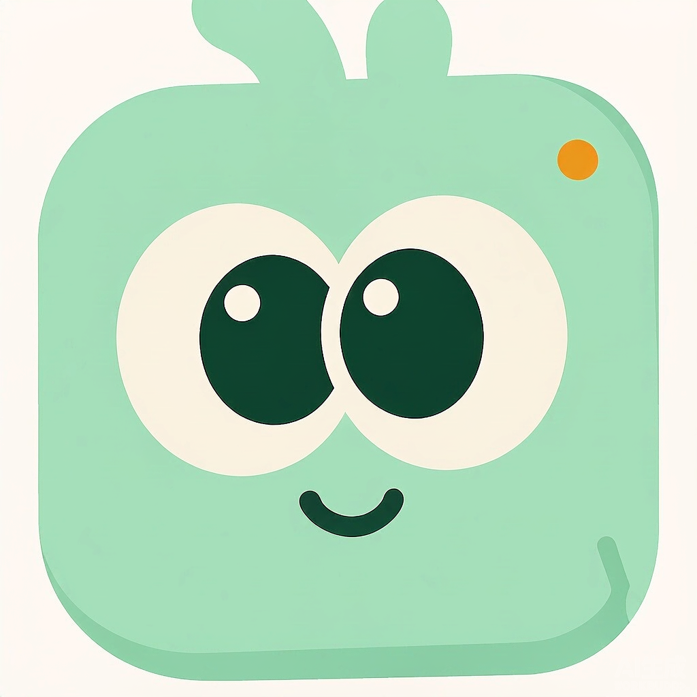
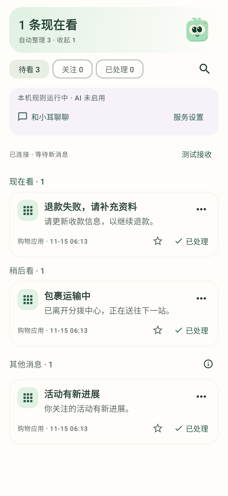
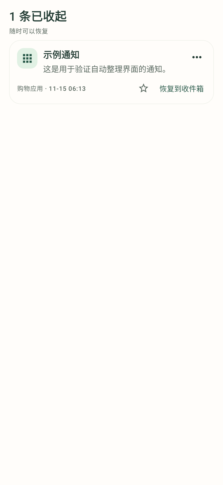
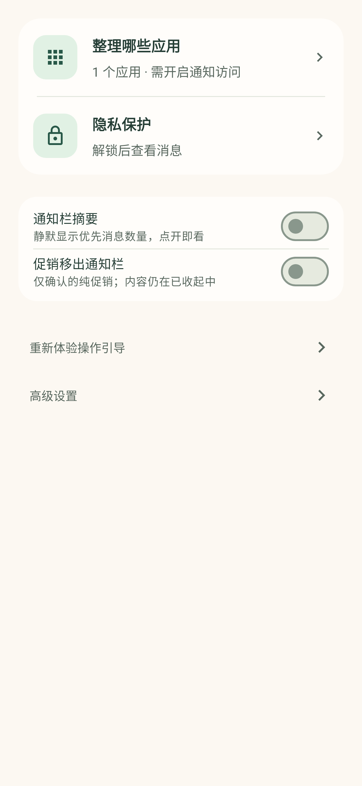

<div align="center">
  
  <h1>轻序 · Qingxu</h1>
  <p><strong>让你听到真正想听的</strong></p>
  <p>一个由你掌控的 Android 通知收件箱。<br>自动整理消息，让需要处理的先被看见。</p>
  <p>
    
    
    
    <a href="LICENSE"></a>
  </p>
  <p><a href="#开始体验">开始体验</a> · <a href="docs/TECHNICAL.md">技术说明</a> · <a href="CONTRIBUTING.md">参与贡献</a></p>
</div>

<br>

<table>
  <tr>
    <td align="center" width="33%"><strong>先看重要的</strong></td>
    <td align="center" width="33%"><strong>收起，也能找回</strong></td>
    <td align="center" width="33%"><strong>设置，只留重点</strong></td>
  </tr>
  <tr>
    <td valign="top"></td>
    <td valign="top"></td>
    <td valign="top"></td>
  </tr>
</table>

<p align="center"><sub>截图由 Robolectric 渲染，使用虚构数据，非真机截图；设置图展示内容区域。</sub></p>

## 少一点判断，多一点专注

消息、促销、物流和日程挤在一起时，真正需要处理的事很容易被淹没。轻序从你选定的应用收纳通知，先替你整理，再把决定权留给你。

- **打开就有重点。** 消息分为「现在看」「稍后看」「待确认」，明确的营销可以收起；拿不准的内容保持可见。
- **随时纠正，随时找回。** 查看整理原因、星标、调整单条结果，也能单独设置「这类以后少显示」。收起的消息仍可恢复。
- **内容与上传，分别掌控。** 默认遮住正文，验证身份后查看。云端分析默认关闭，可选择哪些应用仅在本机处理。[查看隐私界面](docs/images/privacy.png)

## 开始体验

当前版本 **0.4.3**。暂未提供 GitHub Release 安装包，可按下方步骤自行构建。

安装后跟着页面内指引完成三步：

1. **解锁查看。** 使用手机锁屏密码验证；尚未设置设备锁时，先在系统中设置。
2. **选好应用。** 进入「设置 → 整理哪些应用」，选择来源并开启 Android 通知使用权。
3. **交给轻序整理。** 新通知自动进入收件箱；通过离线示例体验纠正和恢复，无需先配置 API。

## 本机先处理，云端按需开启

本机规则处理明确情况；不确定的消息保留可见。需要更多语义判断时，可在「高级设置」选择 Chat Completions、Claude Messages 或 Jev，填写服务配置并测试，再单独授权来源。测试使用虚构通知，不保存草稿或开启上传。**这些服务在云端运行，端侧 AI 尚未接入。** 详细配置见[技术说明](docs/TECHNICAL.md#配置云端分析)。

默认仅本机来源与锁屏限制优先于云端授权。正文等敏感文本字段加密保存，部分元数据仍为明文；基础脱敏也不等于匿名化。开启云端后，授权范围内的通知内容可能发送至所选服务，已发送的请求无法撤回。具体范围见[技术说明](docs/TECHNICAL.md)。

## 当前做到哪里

轻序目前整理的是**应用内部列表**：不拦截、静音或取消原通知，也不发送新的系统提醒。它只能读取 Android 提供的通知内容，无法恢复系统隐藏的正文或读取完整聊天记录。

0.4.3 调整了服务协议选择、地址填写与连接测试，已通过本地构建、149 项自动化测试和 Lint 检查，具体范围见[验证记录](docs/VERIFICATION-0.4.3.md)。真机与真实云服务的完整联调尚未完成；接口适配与自动化检查不代表分类准确率。

下一步优先验证真机通知接收与后台行为，再评估真实中文通知的判断效果、端侧模型和提醒策略。

## 从源码构建

准备 **JDK 17、Android SDK Platform 35、Build Tools 34.0.0**，在 Android Studio 中配置 SDK，或设置 `ANDROID_HOME` 后运行：

```sh
git clone https://github.com/Alen-hjm/qingxu-android.git
cd qingxu-android
./gradlew :app:assembleDebug :app:testDebugUnitTest :app:lintDebug
```

Windows PowerShell 使用 `.\gradlew.bat` 替代 `./gradlew`。安装包位于 `app/build/outputs/apk/debug/app-debug.apk`。构建环境、模块划分与服务配置见[技术说明](docs/TECHNICAL.md)。

## 一起完善轻序

欢迎反馈真实使用中的困惑、界面问题和可复现的整理案例。提交前请去除通知正文中的个人信息。

[贡献指南](CONTRIBUTING.md) · [安全问题反馈](SECURITY.md) · [验证记录](docs/VERIFICATION-0.4.3.md)

项目最初受到 [qq-live-digest](https://github.com/wc985732-lang/qq-live-digest) 的启发；界面参考 [Things](https://culturedcode.com/things/) 的信息层级与 [Material 3](https://m3.material.io/) 的交互规范，使用 [Jetpack Compose](https://developer.android.com/compose) 构建。

代码与文档采用 [MIT 许可证](LICENSE)。品牌图标、角色图片等素材的使用说明见 [THIRD_PARTY_NOTICES.md](THIRD_PARTY_NOTICES.md)。
