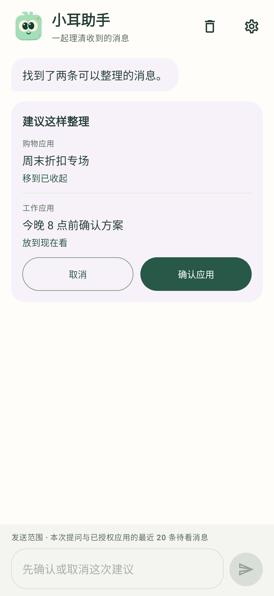

<div align="center">
  
  <h1>轻序 · Qingxu</h1>
  <p><strong>让你听到真正想听的</strong></p>
  <p>一个由你掌控的 Android 通知收件箱。<br>自动整理消息，也能和小耳聊聊，理清眼前的事。</p>
  <p>
    
    
    
    <a href="LICENSE"></a>
  </p>
  <p><a href="#开始体验">开始体验</a> · <a href="docs/TECHNICAL.md">技术说明</a> · <a href="CONTRIBUTING.md">参与贡献</a></p>
</div>

<br>

<table>
  <tr>
    <td align="center" width="33%"><strong>先看重要的</strong></td>
    <td align="center" width="33%"><strong>说一句，一起整理</strong></td>
    <td align="center" width="33%"><strong>设置，只留重点</strong></td>
  </tr>
  <tr>
    <td valign="top"></td>
    <td valign="top"></td>
    <td valign="top"></td>
  </tr>
</table>

<p align="center"><sub>截图由 Robolectric 渲染，使用虚构数据，非真机截图；设置图展示内容区域。</sub></p>

## 少一点判断，多一点专注

消息、促销、物流和日程挤在一起时，真正需要处理的事很容易被淹没。轻序从你选定的应用收纳通知，先替你整理，再把决定权留给你。

- **先看重点。** 本机自动整理新通知，急事优先、普通消息稍后看，明确促销收起。
- **说说你想怎么整理。** 从首页进入小耳助手，问「现在先看什么」，或请它找出需要回复的消息。涉及改动，先看建议再确认，应用后可撤销上一次整理。
- **看完就放下。** 一键标记「已处理」，需要时恢复待看；收起的消息也能找回。
- **越用越合意。** 记住优先会话或收起某应用的促销，偏好随时可撤销。
- **隐私由你决定。** 默认遮住正文、关闭云端；解锁后查看，按应用授权上传。[查看隐私界面](docs/images/privacy.png)

## 开始体验

当前版本 **0.6.0**。暂未提供 GitHub Release 安装包，可按下方步骤自行构建。

安装后跟着页面内指引完成三步：

1. **解锁查看。** 使用手机锁屏密码验证；尚未设置设备锁时，先在系统中设置。
2. **选好应用。** 进入「设置 → 整理哪些应用」，选择来源并开启 Android 通知使用权。
3. **测试接收。** 发送一条真实系统测试通知，确认轻序能收到，再开始自动整理。离线示例可先体验，无需配置 API。

## 本机先处理，云端按需开启

本机规则先给出结果，云端按授权补充判断。可在「高级设置」配置 Chat Completions、Claude Messages 或 Jev；失败或锁屏暂停时保留本机结果。**这些服务运行在云端，端侧 AI 尚未接入。** 配置与连接测试见[技术说明](docs/TECHNICAL.md#配置云端分析)。

首页会显示 AI 是否开启、有无授权来源、正在分析还是连接失败；实际完成的 AI 整理与本机规则分开呈现。填好配置不等于正在请求模型。

**小耳只看你允许的范围。** 对话支持 Chat Completions 与 Claude Messages，Jev 继续用于自动判断。每次最多分析最近 20 条符合授权的未处理通知，连同本次提问及有限的近期对话上下文发送；仅本机来源不参与。聊天只保留在内存，进入后台、锁回或授权变化后清除，最近一次撤销入口也随之失效。它不是完整聊天记录搜索。[了解对话范围](docs/TECHNICAL.md#和小耳对话整理)

默认仅本机来源与锁屏限制优先于云端授权。正文等敏感文本字段加密保存，部分元数据仍为明文；基础脱敏也不等于匿名化。开启云端后，授权范围内的通知内容可能发送至所选服务，已发送的请求无法撤回。具体范围见[技术说明](docs/TECHNICAL.md)。

## 当前做到哪里

默认整理轻序内部列表。另有两个**默认关闭**的选项：通知栏只显示待看重点的数量摘要；确认的纯促销可从原通知栏移除，并保留在「已收起」。原通知先到 Android，轻序无法阻止它第一次响铃或振动；列表恢复也不会重新发布已移除的原通知。

轻序只能读取 Android 提供的通知内容，无法恢复被隐藏的正文或完整聊天记录。接收自测验证当前系统通知链路，有限重连仍需系统配合；真机、真实云服务及持续后台接收尚未完成完整验证。构建与自动化检查见[验证记录](docs/VERIFICATION-0.6.0.md)，不代表分类准确率或真机流畅度。

下一步优先验证真机通知接收与后台行为，再评估真实中文通知的判断效果、端侧模型和提醒策略。

## 从源码构建

准备 **JDK 17、Android SDK Platform 35、Build Tools 34.0.0**，在 Android Studio 中配置 SDK，或设置 `ANDROID_HOME` 后运行：

```sh
git clone https://github.com/Alen-hjm/qingxu-android.git
cd qingxu-android
./gradlew :app:assembleDebug :app:testDebugUnitTest :app:lintDebug
```

Windows PowerShell 使用 `.\gradlew.bat` 替代 `./gradlew`。安装包位于 `app/build/outputs/apk/debug/app-debug.apk`。构建环境、模块划分与服务配置见[技术说明](docs/TECHNICAL.md)。

## 一起完善轻序

欢迎反馈真实使用中的困惑、界面问题和可复现的整理案例。提交前请去除通知正文中的个人信息。

[贡献指南](CONTRIBUTING.md) · [安全问题反馈](SECURITY.md) · [验证记录](docs/VERIFICATION-0.6.0.md)

项目最初受到 [qq-live-digest](https://github.com/wc985732-lang/qq-live-digest) 的启发；界面参考 [Things](https://culturedcode.com/things/) 的信息层级与 [Material 3](https://m3.material.io/) 的交互规范，使用 [Jetpack Compose](https://developer.android.com/compose) 构建。

代码与文档采用 [MIT 许可证](LICENSE)。品牌图标、角色图片等素材的使用说明见 [THIRD_PARTY_NOTICES.md](THIRD_PARTY_NOTICES.md)。
