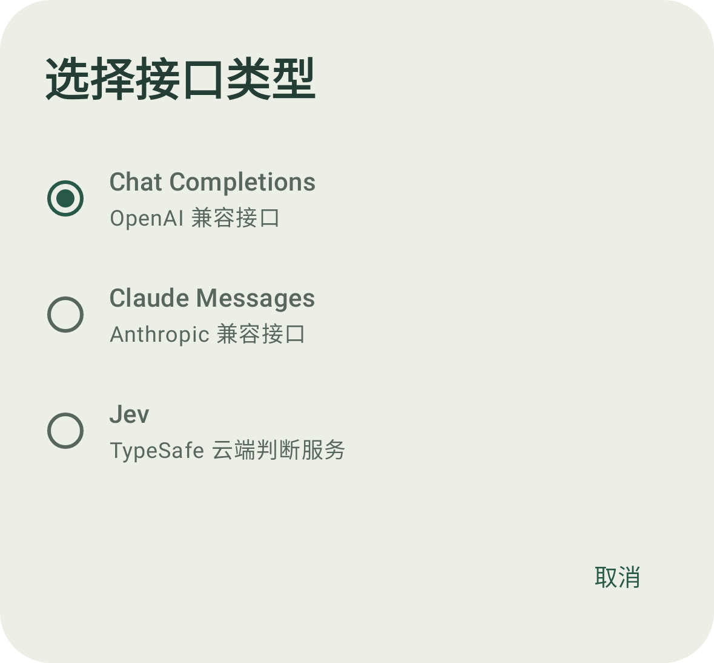
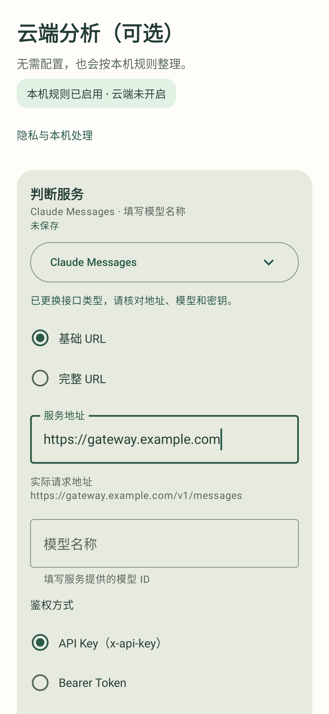

# 轻序 0.4.3 验证记录

日期：2026-10-14

本版修正 API 地址配置与测试流程，并参考 CC Switch 的协议、地址模式与 Claude 鉴权选择。保留低频「高级设置」入口，日常设置不增加技术配置。

## 本次变更

- 新增 Claude Messages 适配器，与 Chat Completions、Jev 分别生成请求和解析响应。
- 基础 URL 按协议补全请求路径，完整 URL 保留自定义路径；展示实际请求地址，拒绝明确的协议路径冲突。已有配置升级时保留完整 URL 含义。
- Claude 支持 `x-api-key` 或 Bearer Token，发送所选的一种凭据头与 `anthropic-version`。
- 测试使用当前草稿和固定虚构通知，不保存配置、开启云端或改变来源授权。成功必须通过响应格式与分类结构校验。
- 细分网络、HTTPS、HTTP 状态与响应格式错误，不回显服务错误正文或密钥。
- 协议采用单选列表；地址模式、鉴权和来源使用整行触控。摘要与测试对象保持一致，草稿标为「未保存」。
- 保存失败保留草稿密钥；切换主机、端口、协议或 Claude 鉴权方式清空旧草稿密钥，不借用其他服务的已存密钥。离页或修改配置使旧测试失效；阻塞网络写入可响应取消。

## 自动化验证

本地 `assembleDebug`、`testDebugUnitTest`、`lintDebug` 全部通过。22 个测试类、149 项测试，0 失败、0 错误。

新增或更新覆盖：地址补全与完整路径、旧设置迁移、鉴权头、草稿不改变存储与授权、密钥复用边界、Claude 请求及严格响应解析、HTTPS 传输和取消、错误消息、选择控件、失败后保留输入、收起配置后的草稿摘要，以及 1.8 倍字体下的操作可达性。

HTTP 测试注入本地模拟连接，没有向真实服务发送请求。Lint 为 0 错误、3 项原有提示：冗余 v26 图标目录、可迁移至 KSP、缺少单色启动图标。

## 界面检查

检查协议选择弹窗、Claude 地址与鉴权、失败结果和 1.8 倍字体截图。以下图片来自 Robolectric 原生图形渲染和虚构配置，不是真机，也不展示真实密钥。

  
  

0.4.2 记录的完整导航截图右边缘裁剪问题仍待真机确认；本版未将其标记为已修复。

## 安装包与范围

本地构建产物 `qingxu-0.4.3-debug.apk`，versionCode 8，Android 8.0+，18,623,519 字节。Android Debug v2 签名验证通过。此文件未提交到 Git，其他环境重新构建的包可能有不同哈希与签名。

SHA-256：`9F918F879440A7E0EA84353B562A74EC780C34A4C3D4DAE2FFCD8F761CC981C1`。

尚未完成真机或真实服务账号联调，不能据此断言某个中转服务可用或模型分类准确。本版未支持 Responses API；本机仍为规则处理。应用只整理内部列表，不取消原通知或新增系统提醒。云端默认关闭，来源授权、仅本机限制及锁屏保护继续生效。
