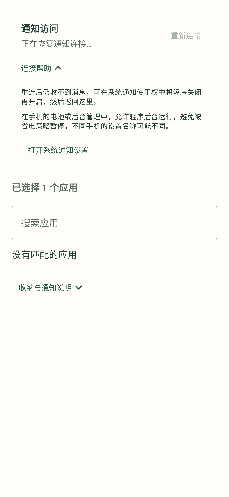

# 轻序 0.4.4 验证记录

日期：2026-10-15

本版针对「先能收消息、后来一直等待系统连接」和「仍需要逐条手动分类」两项反馈，补充监听恢复和入库即本机整理。没有连接用户的手机，不能将代码中的缺口等同于该设备断连的唯一原因。

## 本次变更

- 监听断开、应用进程启动和回到前台时请求系统重新绑定。每轮最多三次，带最小间隔和冷却；只有真实系统连接回调才能标记在线。连接后同步仍有效的系统通知。
- 防止旧监听实例迟到的销毁回调把新实例标为离线；单条异常通知不再中断后续解析。界面区分正在恢复与已断开，提供重新连接和折叠的连接帮助。
- 新通知与变更正文在同一入库事务内获得本机初步结果。明确急事和近期验证码优先、普通聊天与物流稍后看、明确纯营销可收起，正文不足保留在「其他消息」。同正文快照保留已有结果和人工纠正。
- 后台每批先完成本机规则，再执行最多两个云端请求。云端不可用、未授权或锁屏暂停时保留本机结果；新消息与云端重试使用不同队列。每条记录通常最多三次云端尝试，隐私暂停后的重新授权流程与主动重新整理可开启新的处理周期。
- 升级时只重排选定来源中尚未解决的旧本机结果，不覆盖当前人工纠正或已完成的模型结果。「其他消息」不再暗示必须逐条人工分类。

## 自动化验证

本地 `assembleDebug`、`testDebugUnitTest`、`lintDebug` 全部通过。25 个测试类、174 项测试，0 失败、0 错误、0 跳过。Lint 为 0 错误，保留 3 项已有提示：`ObsoleteSdkInt`、`KaptUsageInsteadOfKsp`、`MonochromeLauncherIcon`。

新增或更新覆盖：有限重连、真实连接取消重试、撤销权限、旧实例回调保护、异常通知隔离、入库初分、重复快照与人工优先、升级重排范围、普通与紧急聊天、隐藏正文、敏感凭据不上传、慢云端请求前完成本机批次、每批云端请求上限、逐条重试预算、独立重试队列不阻塞新消息，以及恢复和自动整理界面。

主机内存紧张曾中断测试进程；最终使用较小 JVM 堆、单并行与每个测试类独立进程完成整套任务，没有排除测试。接口测试使用模拟连接或替代 Worker，没有访问真实云端。规则评估使用合成通知，不代表真实分类准确率。

## 界面检查

检查自动分区、断开与恢复状态、展开连接帮助，以及锁屏暂停云端时保留本机结果。以下图片由 Robolectric 原生图形渲染，使用虚构通知，并非真机截图。

  
  
  

更多状态：[连接已断开](images/inbox-disconnected.png) · [其他消息说明](images/automatic-other-messages.png) · [本机已整理，锁屏暂停云端](images/local-first-cloud-paused.png)。

首页自动整理数量排除人工纠正和「其他消息」；其他消息说明与厂商后台帮助默认折叠，日常设置保留原有两个主要入口。

0.4.2 记录的完整导航截图右边缘裁剪问题仍待真机确认；本版未将其标记为已修复。

## 安装包与范围

本地构建产物 `qingxu-0.4.4-debug.apk`，versionCode 9，Android 8.0+，18,535,127 字节。Android Debug v2 签名验证通过，签名证书与本机提供的 0.4.3 包一致；覆盖升级仍待真机确认。此文件未提交到 Git，其他环境重新构建的包可能有不同哈希与签名。

SHA-256：`D59C85C0E9C1CE6C05F53FCA70C790A42A982F225CF9AE4ECCD53A004213F7A8`。

本机处理仍是规则，不是端侧 AI。云端默认关闭，仅授权来源可上传，默认仅本机来源与锁屏限制继续优先生效。服务错误不会回显通知内容或密钥。

未连接 Android 真机或真实云服务账号联调，因此尚未验证厂商省电／后台限制、长时间熄屏收件、真实中文语义判断或覆盖安装。有限重绑不是常驻保活，无法绕过强行停止；只能同步系统仍保留的通知，无法补回已被系统移除或隐藏的正文。本版仍只整理轻序内部列表，不取消原通知或追加系统提醒。
