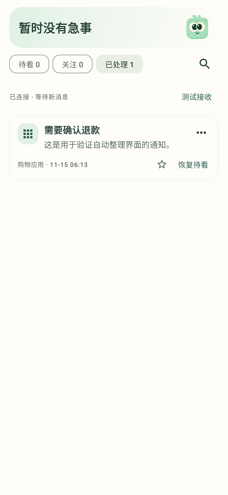

# 轻序 0.5.0 验证记录

日期：2026-10-15

本版围绕「接收状态不清楚、自动整理感不强、阅读负担大」改善日常流程。用户选择来源后，轻序先给出整理结果；看完可标记已处理，仅在结果不合适时纠正。

## 本次变更

- **更轻的收件箱。** 标题与正文成为卡片重点，判断理由和纠正选项移入「整理详情」与菜单。搜索默认收起，新增待看／关注／已处理切换；操作引导用页面内的虚构通知展示自动整理，不写入历史、不上传。
- **已处理与恢复。** 标记操作核对通知 key、内容版本和 hash，迟到结果不能覆盖新消息；同正文快照保留已处理，新正文重新进入待看。恢复保留现有分类，未完成的分析可继续。
- **可撤销偏好。** 已知聊天来源可按同一应用与通知标题记住「这个会话优先」，不宣称识别真实联系人。长期收起仅适用于明确纯促销；旧版过宽的非促销隐藏结果在数据库迁移时恢复可见并等待重整。
- **接收有可验证的状态。** 最近接收时间来自成功保存的来源通知。真实系统自测只有在监听器收到匹配 token 后才成功，超过 10 秒提示检查连接；重复测试不会被上一轮计时器移除。测试通知不进入历史或云端。
- **可选通知栏功能。** 数量摘要和确认的纯促销移除均默认关闭。摘要不含正文；移除前复查活跃通知包名、key、内容 hash，并排除人工纠正、已处理、关注、敏感凭据、常驻与分组汇总等情况。记忆偏好产生的结果不直接触发系统移除。
- **设置与隐私一致。** 来源页显示已选应用及实际处理方式；仅本机来源不能在云端选择器中误授权。首次开启摘要经过系统通知权限页面后，如果查看会话锁回，需要继续验证设备凭据才保存。排队等待中的敏感修改在取得处理锁后重新检查查看授权。

## 自动化验证

本地 `assembleDebug`、`testDebugUnitTest`、`lintDebug` 全部通过：31 个测试类、219 项测试，0 失败、0 错误、0 跳过。Lint 为 0 错误，保留 3 项已有提示：`ObsoleteSdkInt`、`KaptUsageInsteadOfKsp`、`MonochromeLauncherIcon`。

覆盖本机规则和模型响应、接口地址与鉴权、入库初分、重复快照、加密存储与 Room v1→v4 迁移、迟到结果、人工优先、已处理闭环、可撤销偏好、隐私限制、真实接收自测状态、促销移除条件、有限重连与重试，以及 Compose 引导、来源与服务配置交互。

新增隐私竞态测试使用真实 Room 与测试 AES 密钥，模拟操作等待处理锁期间会话锁回，确认设置、通知、偏好和来源授权不提交，也不安排分析任务。测试中的数据基准取自保存后的读取结果，包含加密版本标记。

本地低堆配置曾导致 Lint 内存不足；最终改用 1 GB Gradle 堆、单并行、每个测试类独立的 384 MB 测试进程，没有排除测试。接口与系统通知测试使用 Robolectric、模拟连接或替代 Worker，未连接真实云账号；测试通过不代表真实分类准确率或厂商后台可靠性。

## 界面检查

检查紧凑收件箱、已处理恢复、接收测试状态、设置、来源隐私限制及大字体引导。图片由 Robolectric 渲染，使用虚构数据，并非真机截图。

  
  
  

[自动整理引导](images/guide-automatic.png) · [接收测试成功状态](images/receiving-test.png) · [连接恢复](images/inbox-reconnecting.png) · [连接帮助](images/source-connection-help.png)。接收测试成功截图仅验证界面状态，不是连接手机成功的证据。

完整导航及大字体设置截图的右侧卡片圆角仍有裁剪现象，尚未确认是否仅为渲染环境问题，需真机检查。本版不将该问题记为已修复。

## 安装包

本地产物 `qingxu-0.5.0-debug.apk`，versionCode **10**，Android **8.0+**，**18,775,048 字节**。Android Debug v2 签名验证通过，证书与本机提供的 0.4.4 包一致；实际覆盖升级仍待真机确认。APK 未提交到 Git，其他环境重新构建可能产生不同哈希与签名。

SHA-256：`A7177FB81796C1F303A5F3A98D431FB1773A6A2918BF210F9E62EB4D40EA1CE5`。

## 验证边界

没有连接 Android 真机，也没有真实云账号完成联调。仍需在目标手机验证系统凭据与通知权限衔接、覆盖安装、长时间熄屏接收、厂商省电限制、通知正文可见性、通知栏摘要与纯促销移除，以及真实中文消息的整理质量。

本机处理是规则，端侧 AI 尚未接入；云端默认关闭，默认仅本机来源与锁屏限制优先。基础脱敏不能保证识别全部隐私，已发出的请求无法撤回。有限重绑需要系统配合，无法保证绕过强行停止或补回已经消失的系统通知。

Android 先发布来源通知，轻序随后才能处理，因此不能阻止原通知第一次响铃、振动或显示。恢复轻序列表、关闭移除开关都不会重新发布已取消的原通知。当前没有定时摘要、消息正文摘要或主动紧急响铃策略。
