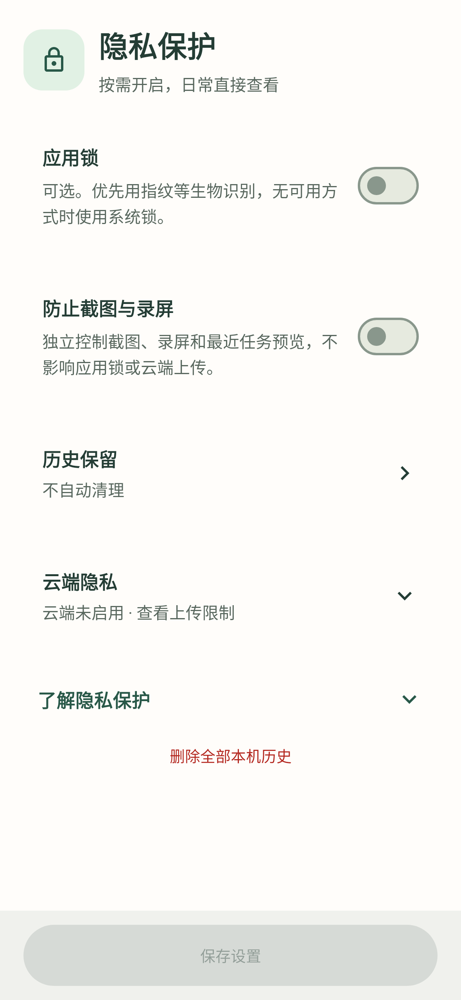

# 轻序 0.6.1 验证记录

日期：2026-10-15

本版调整应用锁与截图保护的使用方式，减少阅读消息和短暂切换应用时的重复验证。0.6.0 的验证结果保留在[历史记录](VERIFICATION-0.6.0.md)，不作为本版构建结论。

## 本次变更

- **新安装直接查看。** 应用锁默认关闭，无需先验证即可查看通知、进入设置和使用已配置功能。云端分析仍默认关闭，不因取消应用锁而自动允许上传。
- **截图独立可选。** 「防止截图与录屏」默认关闭，与应用锁分别保存。开启后使用 `FLAG_SECURE` 请求系统限制截图、录屏和最近任务预览；Android 13+ 在应用锁或防截图任一开启时，另行关闭最近任务截图。
- **减少重复解锁。** 应用锁开启后优先使用可用的系统生物识别，包括指纹；没有可用生物识别时使用系统锁凭据。启用应用锁需要验证，取消验证不保存启用操作；没有设备锁时先引导设置。
- **前台不计时。** 解锁后持续在前台使用不会按固定时长锁回；真正进入后台后有 60 秒返回宽限，宽限结束或设备锁屏时失效。主动锁定立即生效，进程重启不会保留查看授权。
- **通知入口复用页面。** 主页面采用 `singleTask`，摘要通知带 `CLEAR_TOP | SINGLE_TOP`，避免重复打开页面时，旧页面的后台回调触发新页面的锁定。返回保留现有页面，不重置到收件箱。
- **保留原有选择。** 新默认只适用于未保存相应开关的配置。已经保存的应用锁或防截图选择不因升级自动关闭；需要时可在隐私页主动修改。仍然开启的应用锁须通过验证后关闭。
- **对话与查看授权分开。** 真正进入后台（`onStop`）即清除内存聊天、待确认建议及撤销信息，并取消请求；短暂系统弹层触发 `onPause` 不会单独锁回或清空。聊天不会因应用锁仍在 60 秒宽限内而继续保留。

## 自动化验证

本地 `assembleDebug`、`testDebugUnitTest`、`lintDebug` 全部通过：38 个测试类、304 项测试，0 失败、0 错误、0 跳过。Lint 为 0 错误，保留 3 项已有提示：`ObsoleteSdkInt`、`KaptUsageInsteadOfKsp`、`MonochromeLauncherIcon`。最终构建耗时 4 分 14 秒。

使用 JDK 17、单并行、1 GB Gradle 堆、每个测试类独立的 384 MB 测试进程完成，没有排除测试。协议测试使用模拟传输，数据库测试使用真实 Room 与测试 AES 密钥；生物识别硬件及系统凭据界面的真实交互仍待手机验证。

测试覆盖新安装默认值、既有偏好读取、应用锁与截图独立保存、前台保持、后台宽限与重复回调、屏锁立即失效、失效认证回调不能恢复会话、启用应用锁前的授权检查、截图开关不触发历史重新分析，以及大字体设置操作。真实 MainActivity 测试检查 `FLAG_SECURE` 的初始和动态切换、Android 8 的 AppCompat 弹窗主题兼容性、摘要通知入口契约和通知重入后会话保持；Robolectric 不完整模拟系统任务栈，不据此声称真机入口行为已经验证。

## 界面检查

已检查隐私页与设置内容页：应用锁和防截图分别展示，初始均为关闭；云端隐私默认折叠；保存按钮在有修改时启用。1.8 倍字体的隐私开关、云端限制与保存操作有交互测试覆盖。

 

预览图片使用虚构通知，由 Robolectric 渲染，不是真机截图；只用于检查布局与控件状态。沿用的完整导航及大字体设置截图仍存在右侧圆角裁剪现象，本版不记为已修复。

## 安装包

本地产物 `qingxu-0.6.1-debug.apk`，versionCode **12**，Android **8.0+**，**20,620,743 字节**。Android Debug v2 签名验证通过，证书与本机提供的 0.6.0 包一致；覆盖升级仍待真机确认。APK 不提交到 Git；其他环境重新构建可能产生不同哈希与签名。

SHA-256：`16221883D3488E9EAF5F2E1C88C36402CEB7A4A02A1DB4E4639EF8889F67BE08`。

## 验证边界

应用锁控制查看授权，防截图控制系统窗口行为，云端开关与来源授权控制发送范围，三者互相独立。通知敏感文本字段与 API 密钥仍使用本机加密；并非全库加密，部分元数据仍为明文。默认仅本机来源与云端锁屏限制保持独立，关闭应用锁或允许截图不等于允许上传。

尚未连接 Android 真机完成此版验证。需在目标手机检查指纹或其他生物识别、系统锁回退、后台 60 秒宽限、屏锁与熄屏、系统权限弹层、最近任务缩略图、截图和录屏，以及覆盖安装后的偏好保留。旧 Android 系统仅依赖用户主动开启的防截图选项，不能保证单独开启应用锁就隐藏所有最近任务缩略图；厂商系统表现可能不同。

真实云服务兼容性、中文判断质量、长时间后台通知接收、耗电与流畅度仍需实测。自动化通过不能替代这些结论；已发出的云端请求无法撤回，基础脱敏不等于匿名化。
